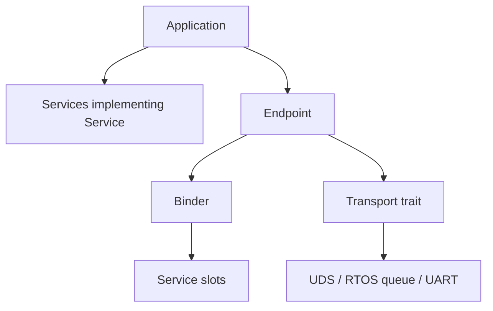

# EmbBinder

[](https://github.com/ecucuk/embbinder/actions/workflows/ci.yml)


A small, transport-agnostic service RPC library for embedded Rust, inspired by the Binder-style IPC used in Android and automotive infotainment systems.

Services register under a numeric ID. Clients send a request (service ID, method ID, payload). The binder dispatches it to the service and returns a response or a typed error. The same core runs over any byte transport: Unix domain sockets today; RTOS queues and UART are next.

## Why

On Linux-based IVI platforms, system services talk to each other through Binder or sockets. On microcontrollers and RTOS targets there is usually no equivalent, so each project grows its own ad-hoc command protocol. EmbBinder tries to give both worlds the same model:

- **One service model** for processes on embedded Linux and tasks on an RTOS
- **A fixed, documented wire format** (24-byte header + payload) that is easy to parse on a small MCU
- **A `Transport` trait** that keeps OS and transport details out of the core

## Features

- `no_std` core with no heap: the application owns the `Binder`, the services and the buffers
- Service registry with a fixed number of slots and numeric service IDs
- Request / Response / Event / Error message types
- Error replies for unknown services, service errors and oversized responses; malformed input is dropped
- Bounds-checked `Writer` and `Reader` over caller buffers; `read_string` returns a `&str` into the payload
- `Endpoint`: reads one framed message per `poll()`, dispatches it and sends the reply
- `UdsTransport` (feature `std`, Unix only): Unix domain sockets with framing and send timeouts
- Integration tests and golden wire bytes; CI on Linux and macOS with `clippy -D warnings`, `rustfmt` and a `thumbv7em-none-eabihf` build

## Architecture



| File | Responsibility |
|---|---|
| `src/message.rs` | `MessageHeader`, `MsgType`, `MAGIC`, `VERSION` |
| `src/error.rs` | `ErrorCode` |
| `src/serializer.rs` | `Writer`, `Reader` |
| `src/binder.rs` | `Service`, `Binder`, `ProcessError` |
| `src/transport.rs` | `Transport`, `TransportError` |
| `src/endpoint.rs` | `Endpoint`, the poll loop |
| `src/uds.rs` | `UdsTransport` (`std` on Unix) |

Details: [architecture](docs/architecture.md) · [message format](docs/message_format.md) · [porting guide](docs/portability.md)

## Wire format

```
+--------+---------+----------+------------+-----------+--------------+------------+---------+
| magic  | version | msg_type | service_id | method_id | payload_size | request_id | payload |
| 4 B    | 2 B     | 2 B      | 4 B        | 4 B       | 4 B          | 4 B        | N bytes |
+--------+---------+----------+------------+-----------+--------------+------------+---------+
  'EMBB'    1        1=Request 2=Response 3=Event 4=Error
```

All fields are little-endian.

## Quick start

```bash
git clone https://github.com/ecucuk/embbinder.git
cd embbinder
cargo test
cargo run --example basic_service
```

For a target with no operating system, disable the default features:

```toml
[dependencies]
embbinder = { path = "...", default-features = false }
```

## Defining a service

```rust
use embbinder::{ErrorCode, Reader, Service, Writer};

struct CalculatorService;

impl Service for CalculatorService {
    fn handle(
        &mut self,
        method_id: u32,
        payload: &[u8],
        response: &mut [u8],
    ) -> Result<usize, ErrorCode> {
        if method_id != 1 {
            return Err(ErrorCode::MethodNotFound);
        }
        let mut request = Reader::new(payload);
        let sum = request.read_i32()?.wrapping_add(request.read_i32()?);

        let mut writer = Writer::new(response);
        writer.write_i32(sum)?;
        Ok(writer.len())
    }
}
```

`Err` sends a `MsgType::Error` reply to the client.

## Serving requests

```rust,ignore
use embbinder::{Binder, Endpoint, UdsTransport};

let mut calculator = CalculatorService;
let mut binder = Binder::<4>::new(); // at most 4 services
binder.register_service(100, &mut calculator)?;

// 256 is the maximum message size.
let mut endpoint = Endpoint::<_, 256>::new(UdsTransport::open("/tmp/calc.sock")?);
loop {
    if let Err(code) = endpoint.poll(&mut binder, 1000) {
        log::warn!("request failed: {code:?}");
    }
}
```

A complete client/server round trip is in [`examples/basic_service.rs`](examples/basic_service.rs); the UDS endpoint test shows the transport path end to end.

## Status and roadmap

EmbBinder is an early-stage project. The core is allocation-free and the wire encoding is explicit little-endian; the POSIX path works and is tested. Known limitations, in the order I plan to address them:

- [x] **Allocation-free core.** `Binder`, `Writer`, `Reader` and `Endpoint` use fixed-capacity slots and caller-provided buffers.
- [x] **Explicit wire encoding.** The header is encoded and decoded field by field in little-endian.
- [ ] **RTOS transport** (for example a FreeRTOS queue) through the `Transport` trait.
- [ ] **UART transport** with frame delimiting and CRC.
- [ ] **Client proxies.** A small client API (or generated stubs) instead of building headers by hand.
- [ ] **Footprint numbers** measured on a Cortex-M target.

Issues and suggestions are welcome.

## License

MIT, see [LICENSE](LICENSE).

---

Author: [Ergün Cücük](https://www.linkedin.com/in/ecucuk/), embedded software engineer working on automotive infotainment (Linux, Android Automotive, RTOS).
