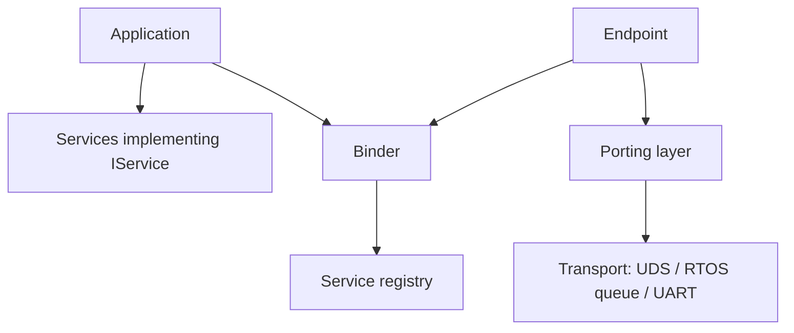

# EmbBinder

[](https://github.com/ecucuk/embbinder/actions/workflows/ci.yml)


A small, transport-agnostic service RPC library for embedded C++, inspired by the Binder-style IPC used in Android and automotive infotainment systems.

Services register under a numeric ID. Clients send a request (service ID, method ID, payload). The binder dispatches it to the service and returns a response or a typed error. The same core runs over any byte transport: Unix domain sockets today; RTOS queues and UART are next.

## Why

On Linux-based IVI platforms, system services talk to each other through Binder or sockets. On microcontrollers and RTOS targets there is usually no equivalent, so each project grows its own ad-hoc command protocol. EmbBinder tries to give both worlds the same model:

- **One service model** for processes on embedded Linux and tasks on an RTOS
- **A fixed, documented wire format** (24-byte header + payload) that is easy to parse on a small MCU
- **A porting layer** that keeps OS and transport details out of the core

## Features

- Service registry with numeric (and string) service IDs
- Request / Response / Event / Error message types
- Error replies for unknown services and oversized responses; malformed input is dropped
- Bounds-checked `Serializer` for primitives, strings and raw buffers
- `Endpoint`: reads one framed message per `poll()`, dispatches it and sends the reply
- POSIX port: clock, thread, mutex, semaphore, memory, logger and a UDS transport with framing
- Unit and integration tests; CI on Linux and macOS with `-Werror` and a clang-format check

## Architecture



| Layer | Responsibility |
|---|---|
| `core` | `Binder`, `ServiceRegistry`, `IService`, `Serializer`, `Endpoint` |
| `port` | OS and transport abstraction (`Clock`, `Thread`, `Mutex`, `Semaphore`, `Memory`, `Logger`, `Transport`) |
| `utils` | `Span`, `StaticVector`, byte-order helpers |

Details: [architecture](docs/architecture.md) · [message format](docs/message_format.md) · [porting guide](docs/portability.md)

## Wire format

```
+--------+---------+------+------------+-----------+--------------+------------+---------+
| magic  | version | type | service_id | method_id | payload_size | request_id | payload |
| 4 B    | 2 B     | 2 B  | 4 B        | 4 B       | 4 B          | 4 B        | N bytes |
+--------+---------+------+------------+-----------+--------------+------------+---------+
  'EMBB'    1        1=Request 2=Response 3=Event 4=Error
```

## Quick start

```bash
git clone https://github.com/ecucuk/embbinder.git
cd embbinder
cmake -S . -B build -DCMAKE_BUILD_TYPE=Release
cmake --build build -j
ctest --test-dir build --output-on-failure
./build/basic_service
```

Requires CMake 3.10+ and a C++17 compiler (GCC, Clang or MSVC).

## Defining a service

```cpp
#include "embbinder/core/binder.hpp"
#include <cstring>

using namespace embbinder::core;

class CalculatorService : public IService {
public:
  enum Method : uint32_t { ADD = 1 };

  void handle(uint32_t method_id, const uint8_t *payload, uint32_t payload_size,
              uint8_t *response_buf, uint32_t response_capacity,
              uint32_t &response_size) override {
    if (method_id != ADD) return;               // no response -> caller sees empty reply

    Serializer req;
    req.attach_buffer(payload, payload_size);
    auto a = req.read_int32();
    auto b = req.read_int32();
    if (!a.is_ok() || !b.is_ok()) return;       // malformed arguments

    Serializer resp;
    resp.write_int32(a.value() + b.value());
    if (resp.size() > response_capacity) return; // never overrun the caller's buffer
    std::memcpy(response_buf, resp.data(), resp.size());
    response_size = static_cast<uint32_t>(resp.size());
  }
};

int main() {
  CalculatorService calc;
  Binder::instance().register_service(100, &calc);
  // Feed incoming frames to Binder::instance().process_message(...),
  // or let an Endpoint do it over a transport.
}
```

A complete client/server round trip is in [`examples/basic_service.cpp`](examples/basic_service.cpp); the UDS endpoint test shows the transport path end to end.

## Status and roadmap

EmbBinder is an early-stage project. The POSIX path works and is tested; the RTOS side is not there yet. Known limitations, in the order I plan to address them:

- [ ] **Allocation-free core.** The registry, `Serializer` and `Endpoint` currently use `std::map`, `std::string`, `std::vector` and `std::mutex`. For MCU targets these will move to fixed-capacity containers (`StaticVector`) and caller-provided buffers, with the mutex behind the porting layer.
- [ ] **Explicit wire encoding.** The header is copied as a host-endian struct. It will be encoded and decoded field by field in little-endian so mixed-endian peers interoperate.
- [ ] **FreeRTOS port.** The RTOS queue transport is a compile-only stub today.
- [ ] **UART transport** with frame delimiting and CRC.
- [ ] **Client proxies.** A small client API (or generated stubs) instead of building headers by hand.
- [ ] **Footprint numbers** measured on a Cortex-M target.

Issues and suggestions are welcome.

## License

MIT, see [LICENSE](LICENSE).

---

Author: [Ergün Cücük](https://www.linkedin.com/in/ecucuk/), embedded software engineer working on automotive infotainment (Linux, Android Automotive, RTOS).
