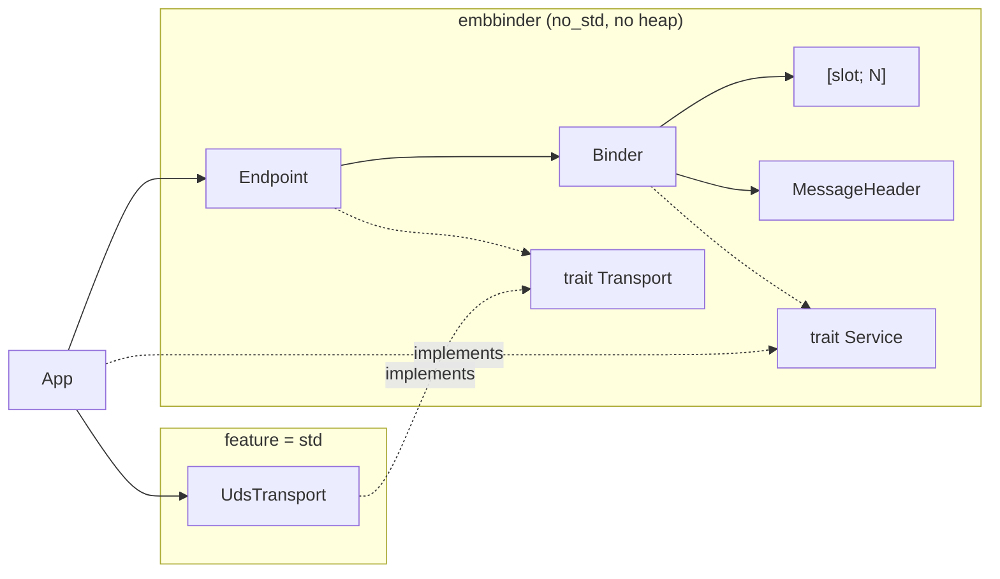

# System Architecture

EmbBinder is one crate with a `no_std` core that needs no heap. One optional module needs `std`.



## Core Components

### 1. Binder
`Binder<'a, N>` is a value that the application owns. It has `N` slots of `(u32, &'a mut dyn Service)`. `process_message` validates a raw message, finds the service with a linear scan and writes the reply. There is no global state and no lock. A multi-threaded application puts the `Binder` in its own mutex.

`process_message` gives `Ok(size)` for a response. A failure gives `ProcessError { code, reply_size }`. If `reply_size` is not 0, the output buffer holds an Error reply for the peer.

### 2. Service
Applications implement this trait:
```rust
pub trait Service: Send {
    fn handle(&mut self, method_id: u32, payload: &[u8], response: &mut [u8])
        -> Result<usize, ErrorCode>;
}
```
The return value is the number of bytes written to `response`. `Err(code)` gives an Error reply. A size larger than `response` gives an `InternalError` reply.

### 3. Endpoint
`Endpoint<T, M>` owns a `Transport` and two `[u8; M]` buffers. `poll(&mut binder, timeout_ms)` reads one message, calls `Binder::process_message` and sends the reply, also for Error replies. It gives `Ok(false)` if no message arrived.

### 4. Writer and Reader
`Writer` writes little-endian values to a `&mut [u8]`. `Reader` reads them from a `&[u8]`. Both check all bounds and give `BufferTooSmall` at the end of the buffer.

### 5. Logging
The crate logs with the `log` crate. The application installs a logger if it wants the output.
