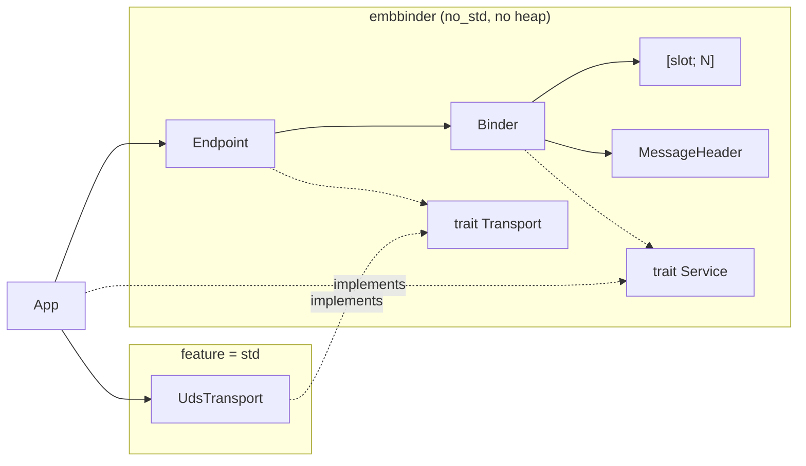
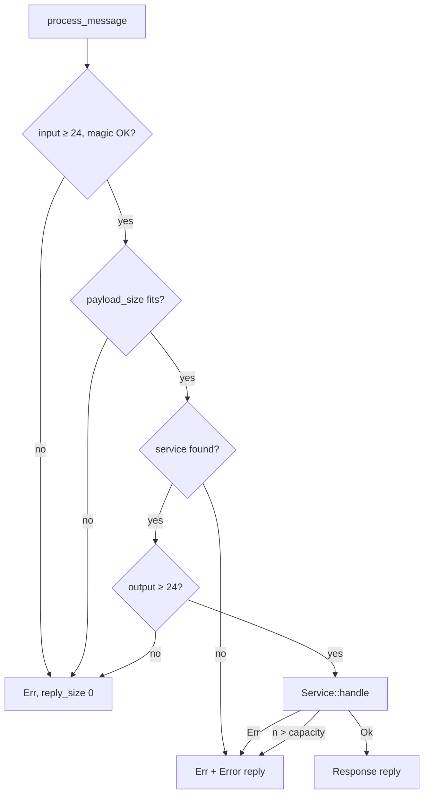

# EmbBinder Rust conversion: design

Date: 2026-11-06. Status: waiting for review.

## Goal

Replace the C++17 library with a Rust crate. The crate core must run on a
microcontroller with no heap. The wire format stays compatible with the C++
version on little-endian hosts.

## Success criteria

1. All scenarios of `tests/test_binder.cpp` and `tests/test_uds_endpoint.cpp`
   pass in Rust, with the adaptations in "Testing".
2. `cargo run --example basic_service` prints `Client: Result = 30`.
3. A C++ client gets correct replies from a Rust server (one interop run before
   the C++ code is removed).
4. `cargo build --no-default-features --target thumbv7em-none-eabihf` passes.
5. CI runs on `cargo` only. No C++ code or CMake files stay in the tree.

## Decisions

| Subject | Decision | Reason |
|---|---|---|
| Target | `no_std`, no heap | The user chose this. It is the purpose of an embedded library. |
| Ownership | `Binder` is a value that the application owns | No global state, no lock, no `unsafe`. The compiler rejects shared access. |
| Crates | One crate, `default = ["std"]` | Only one optional module needs `std`. |
| Logging | `log` crate | It works with `no_std` and no heap. It replaces `port::Logger`. |
| Socket wait | `libc::poll` under `std` | `UnixListener` has no accept timeout. `poll(2)` keeps the C++ behaviour. |

Rejected options:

- A global singleton needs `&'static mut` services, a lock on each platform and
  gives no test isolation.
- Generic dispatch over tuples makes type signatures complex and prevents
  registration at run time.

## Structure



| File | Content |
|---|---|
| `src/lib.rs` | Crate root and re-exports |
| `src/message.rs` | `MessageHeader`, `MsgType`, `MAGIC`, `VERSION` |
| `src/error.rs` | `ErrorCode` |
| `src/serializer.rs` | `Writer`, `Reader` |
| `src/binder.rs` | `Service`, `Binder`, `ProcessError` |
| `src/transport.rs` | `Transport`, `TransportError` |
| `src/endpoint.rs` | `Endpoint` |
| `src/uds.rs` | `UdsTransport`, only with `std` on Unix |
| `examples/basic_service.rs` | Port of `examples/basic_service.cpp` |
| `tests/binder.rs` | Port of `tests/test_binder.cpp` |
| `tests/uds_endpoint.rs` | Port of `tests/test_uds_endpoint.cpp` |
| `tests/wire_format.rs` | Golden bytes from the C++ build |

`unsafe` is forbidden in the crate, except for the single `libc::poll` call in
`src/uds.rs`.

## Public API

```rust
pub trait Service: Send {
    /// Returns the number of response bytes written.
    fn handle(&mut self, method_id: u32, payload: &[u8], response: &mut [u8])
        -> Result<usize, ErrorCode>;
}

pub struct ProcessError { pub code: ErrorCode, pub reply_size: usize }

impl<'a, const N: usize> Binder<'a, N> {
    pub fn new() -> Self;
    pub fn register_service(&mut self, id: u32, service: &'a mut dyn Service)
        -> Result<(), ErrorCode>;
    pub fn process_message(&mut self, input: &[u8], output: &mut [u8])
        -> Result<usize, ProcessError>;
}

pub trait Transport {
    fn send(&mut self, data: &[u8], timeout_ms: u64) -> Result<(), TransportError>;
    fn receive(&mut self, buf: &mut [u8], timeout_ms: u64)
        -> Result<usize, TransportError>;
}

pub enum TransportError { Timeout, NoMemory, InvalidArgument, Internal }

impl<T: Transport, const M: usize> Endpoint<T, M> {
    pub fn new(transport: T) -> Self;
    pub fn poll<const N: usize>(&mut self, binder: &mut Binder<'_, N>, timeout_ms: u64)
        -> Result<bool, ErrorCode>;
}

impl UdsTransport {
    pub fn open(path: &str) -> Result<Self, TransportError>;
}
```

`M` is the maximum message size. It replaces `TransportConfig::max_message_size`.
`Endpoint::new` has a compile-time check that `M` is at least 24.

`Writer<'a>` writes to a `&mut [u8]`. All write functions return
`Result<(), ErrorCode>` and give `BufferTooSmall` when the data does not fit.
`Writer::len()` gives the bytes written. `Reader<'a>` reads from a `&'a [u8]`.
`read_string` returns a `&'a str` with no copy.

Both types have functions for `i32`, `u32`, `i64`, `u64`, `f32`, `f64`, `bool`
and strings. `Writer` also has `write_bytes`. The formats are the same as in C++:
little-endian values, `bool` as one byte, and strings as a `u32` length and the
bytes, with no terminator and no padding.

`ErrorCode` is `#[repr(u32)]` and keeps the C++ wire values:

| Variant | Value |
|---|---|
| `Unknown` | 1 |
| `InvalidArgument` | 2 |
| `OutOfMemory` | 3 |
| `BufferTooSmall` | 4 |
| `ServiceNotFound` | 5 |
| `MethodNotFound` | 6 |
| `SerializationError` | 7 |
| `DeserializationError` | 8 |
| `InternalError` | 9 |
| `InvalidOperation` | 10 |

## Message processing



`input` too short or bad magic gives `InvalidArgument`. A `payload_size` that does
not fit, or `output` shorter than 24 bytes, gives `BufferTooSmall`. An oversized
`n` gives `InternalError`.

An Error reply needs 28 bytes of `output`. If `output` is smaller, `reply_size` is
0. The error code stays the same.

`Endpoint::poll` behaves as in C++:

1. `Transport::receive`. `Timeout` gives `Ok(false)`. Other errors give
   `Err(InternalError)`.
2. `Binder::process_message`.
3. If a reply exists, send it with a timeout of 1000 ms. A send failure gives
   `Err(InternalError)`.
4. Return the code from `process_message`, or `Ok(true)`.

## Behaviour changes from C++

1. `Service::handle` can fail. `Err(code)` gives an Error reply to the client.
   In C++, a service could only return an empty response.
2. The header is little-endian on all hosts. Bytes on little-endian hosts do not
   change. Big-endian hosts become compatible with little-endian peers, and
   stop being compatible with the big-endian C++ build.
3. `read_string` validates UTF-8 and gives `DeserializationError` for bad data.
   C++ accepted all bytes.
4. `ErrorCode::NONE` is removed. `Ok` is the success value.
5. `Transport::open` and `Transport::close` become a constructor and `Drop`.
   `Endpoint::open`, `close` and `is_open` are removed.
6. `register_service` gives `Err(OutOfMemory)` when the slots are full and
   `Err(InvalidOperation)` for a duplicate ID. C++ gave `false`.
7. Service lookup is a linear scan over `N` slots. C++ used `std::map`.
8. The registry has no lock. A multi-threaded application puts the `Binder` in
   its own mutex. `Service: Send` makes this possible. A service that holds a
   raw pointer needs its own `unsafe impl Send`.

## Behaviour that stays the same

- Bound checks use the form `len > total - pos`.
- Malformed input gets no reply.
- There is no version check. The C++ code has a TODO for this, and this
  conversion does not add it.

`UdsTransport` keeps all behaviour of `transport_uds.cpp`:

- `open` connects as a client. If no server listens, it becomes a server.
- A server accepts one peer at a time.
- `open` removes a stale socket file and never removes a regular file.
- After the first byte of a frame, the rest must arrive within 1000 ms.
- A `payload_size` larger than the buffer drops the peer and gives `NoMemory`.
- When a peer closes or stalls during a header, a server gives `Timeout` and
  accepts a new peer. A client gives `Internal`.
- `Drop` does not remove the socket file.

## Not ported

| C++ item | Reason |
|---|---|
| `port::Clock`, `Thread`, `Mutex`, `Semaphore`, `Memory` | Core, tests and examples do not call them. |
| `utils::Span`, `StaticVector`, `ByteOrder` | `&[u8]` and `to_le_bytes` replace them. |
| `ServiceRegistry::remove_service`, name lookup | Nothing calls them. |
| `get_service` | Only `process_message` needs the lookup. |
| `port::Logger`, `LogLevel` | The `log` crate replaces them. |
| `src/ports/rtos/` | It does not compile, and the queue transport is a stub. |

An RTOS transport is out of scope. A later task can add one with the `Transport`
trait.

## Testing

Test adaptations:

- The C++ test with `nullptr` output has no Rust form. An `input` shorter than 24
  bytes tests `InvalidArgument`.
- The test for a regular file at the endpoint path calls `UdsTransport::open`.

New tests:

- `Writer` gives `BufferTooSmall` when the data does not fit.
- `Reader` gives `DeserializationError` for bad UTF-8.
- `Err` from `Service::handle` gives an Error reply.
- `register_service` gives the two errors for full slots and duplicate IDs.

`tests/wire_format.rs` compares the header and payload bytes with hex values from
the C++ build.

The interop run is a one-time check before the C++ removal. A C++ client sends a
request to a Rust server over UDS and checks a Response and an Error reply. The
run uses files in a temporary directory, and they do not go in the repository.

Local tools needed:

```bash
rustup target add thumbv7em-none-eabihf
```

## CI

`.github/workflows/ci.yml` runs these on `ubuntu-latest` and `macos-latest`:

1. `cargo test`
2. `cargo clippy --all-targets -- -D warnings`
3. `cargo fmt --check`
4. `cargo build --no-default-features --target thumbv7em-none-eabihf`
5. `cargo run --example basic_service | grep -q "Result = 30"`

## Removal and updates

Remove `CMakeLists.txt`, `include/`, `src/core/`, `src/ports/`, `src/utils/`,
`examples/basic_service.cpp`, `tests/*.cpp`, `tests/check.hpp`, `scripts/` and
`.clang-format`.

Update `README.md`, `docs/architecture.md`, `docs/message_format.md`,
`docs/portability.md`, `CLAUDE.md`, `.github/workflows/ci.yml`, `.gitignore` and
the three skills in `.claude/skills/`.

Remove the C++ code only after the interop run passes.

## Risks

- `Binder` has no internal lock. C++ had a lock on the registry, but it did not
  protect the services. In Rust, the application mutex protects both, and it
  also allows one `handle` call at a time.
- `Endpoint<T, M>` stores two `[u8; M]` buffers in the struct. A large `M` on a
  small stack needs a `static` placement.
- `rustup`, `log` and `libc` need network access for the first build.
